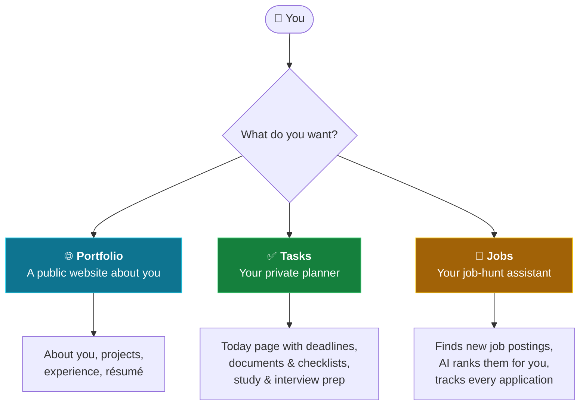
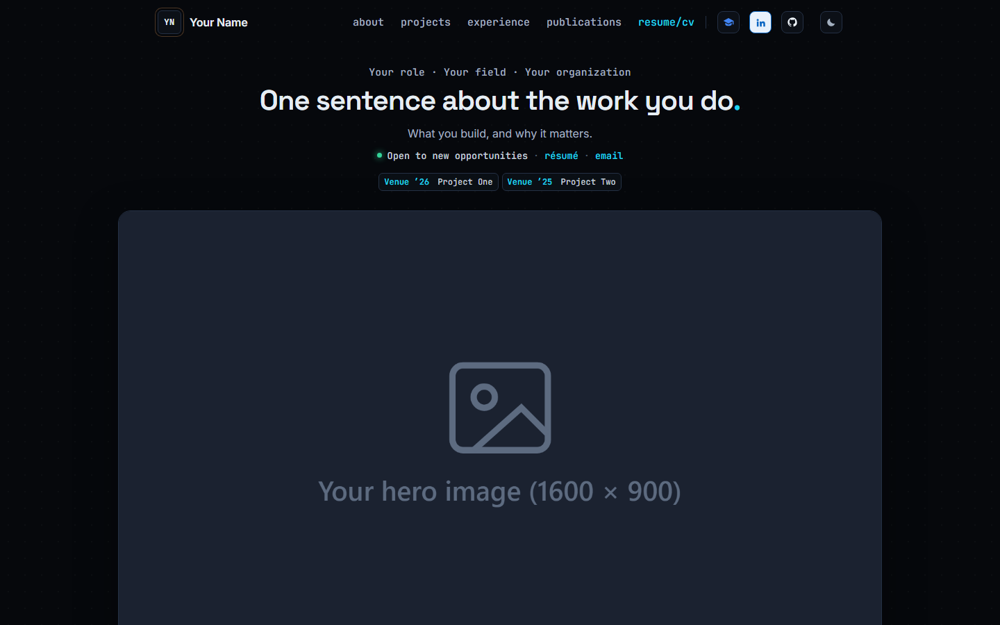
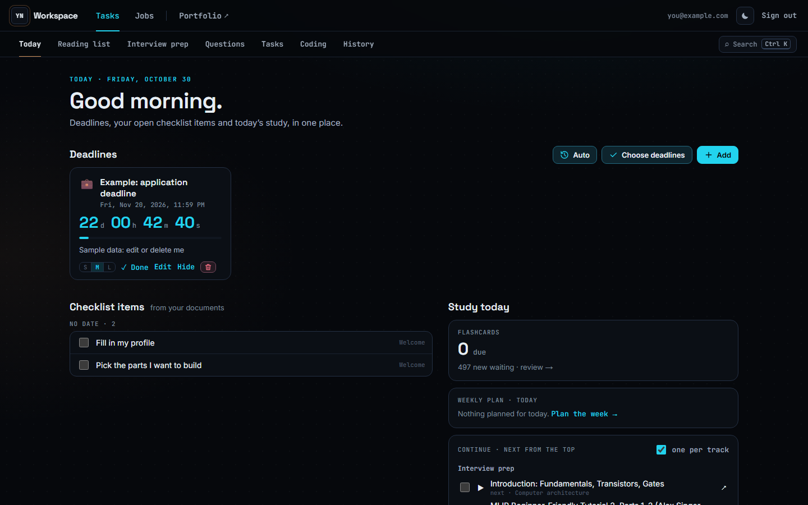
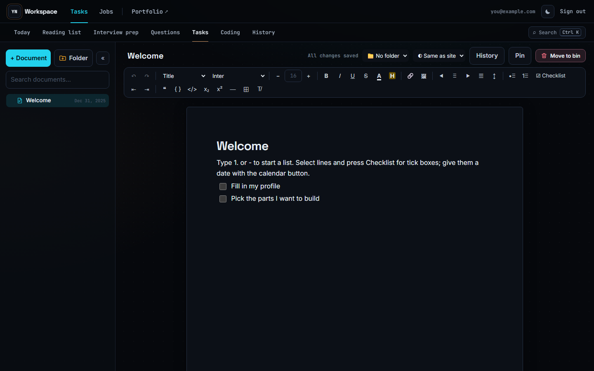
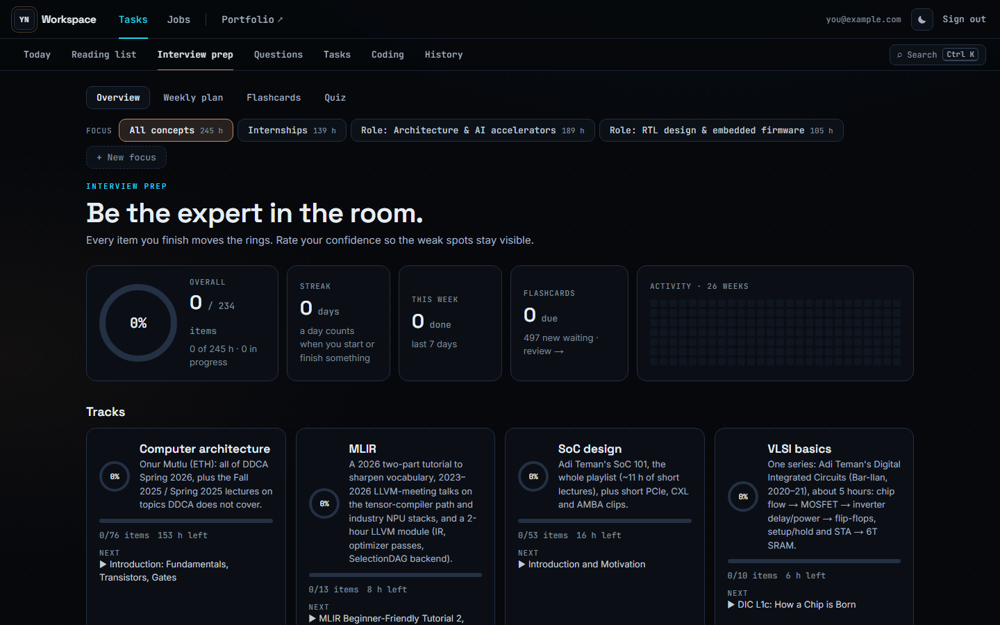
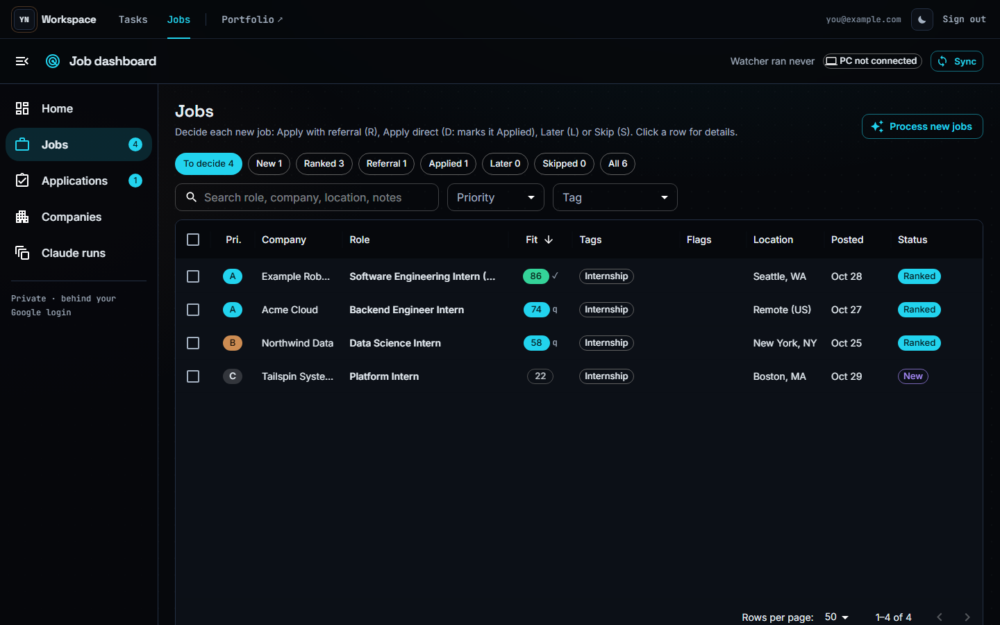

# Portfolio · Tasks · Jobs

**Your own website, your own planner, and your own job-hunt assistant: pick the parts you want, and your AI assistant builds them for you.**

You don't need to know how to code. You talk to an AI coding assistant (like [Claude Code](https://claude.com/claude-code)); it reads the instructions in this folder, asks you a few questions, and sets everything up.

---

## Step 1: Pick what you want

There are **three parts**. Choose **one, two, or all three**. You can add the others later.

| | 🌐 Portfolio | ✅ Tasks | 💼 Jobs |
|---|---|---|---|
| **What it is** | A one-page website that introduces you | A private planner only you can open | An assistant for your job search |
| **Good for** | Sharing a link on your résumé, LinkedIn, e-mails | Deadlines, to-do lists, notes, studying for interviews | Applying to many companies without losing track |
| **Who can see it** | Everyone | Only you (Google login) | Only you (Google login) |
| **Needs** | Nothing extra | Nothing extra | Your PC running the job dashboard + a free GitHub account |
| **Effort to set up** | ⭐ easy | ⭐ easy | ⭐⭐⭐ more steps (the assistant guides you) |

### 🌐 Portfolio: a website about you
Your name and headline, an about section with photos, your projects, experience, publications and résumé, in dark and light themes. It starts with placeholder text and blank images; the assistant fills it in with your details.

### ✅ Tasks: your private planner
- **Today page:** live countdowns to your deadlines, your open to-dos, and what to study today.
- **Documents:** like Google Docs, with folders, checklists with due dates and images. Your text is saved even when you go offline.
- **Interview prep:** study tracks, flashcards, quizzes and practice questions. There's an optional ready-made pack for computer-architecture / chip-design interviews; ask the assistant for one in your field.
- **Also:** a reading list, coding practice, and a search box (Ctrl+K) that finds anything.

### 💼 Jobs: your job-hunt assistant
- **Finds jobs for you:** checks the career pages of the companies you choose, three times a day.
- **Ranks them:** an AI reads each posting and scores how well it fits *your* profile, with a one-line reason.
- **Tracks everything:** you decide each job (apply, ask for a referral, later, skip) and follow it through *referral → applied → interview*.
- **Helps with outreach:** drafts referral and cold e-mail messages for you to send yourself. It never sends anything on its own.

---

## Step 2: Set it up (about 10 minutes)

1. **Make your own copy.** Click the green **Use this template** button at the top of this page, then **Create a new repository**. Make it **Private**, because it will hold your personal details.
2. **Download it to your computer** and open the folder with your AI assistant. With Claude Code, open a terminal in the folder and type `claude`.
3. **Say: `set up my project`.** The assistant will:
   - ask **which parts you want** (Step 1);
   - ask about **you** (name, links, résumé), plus, for Jobs, your field and the companies you like;
   - install everything and show you your site at **http://localhost:4321**.

Then just keep talking to it: "change the headline", "add my new project", "add a deadline for my thesis", "find new jobs".

> **What you need installed:** [Node.js](https://nodejs.org) (version 22 or newer), [Git](https://git-scm.com), and an AI assistant ([Claude Code](https://claude.com/claude-code)).
> **On Windows**, put the folder somewhere short like `C:\code\my-site`. Very long folder paths can break the local database.

---

## Step 3 (optional): Put it online for free

Everything works on your own computer without this step. When you want a public link for your portfolio, or want to open your planner from your phone, you can host it on **Cloudflare**, **free**:

- your website gets an address like `https://your-name.workers.dev` (or your own domain, if you have one);
- **Tasks** and **Jobs** stay private: Cloudflare asks for **your Google login**, and nobody else can get in;
- the portfolio stays public.

Say **"help me put my site online"** and the assistant walks you through it. You create the free accounts and click the buttons; it runs the rest. The written guide is [docs/deploy-cloudflare.md](docs/deploy-cloudflare.md).

---

## Common questions

**Does it cost anything?** No. The hosting (Cloudflare) and the job watcher (GitHub) have free plans that are enough for one person. You do need access to an AI assistant (e.g. a Claude subscription).

**Do I need to know how to code?** No. You describe what you want; the assistant edits the files. Knowing a little helps if you want to customize a lot.

**Is my data private?** Your planner and job tracker sit behind your own Google login. Keep your copy of this repository **private** on GitHub. The assistant is told never to make up facts about you, never to put passwords in files, and never to submit applications or send messages for you.

**Can I start with one part and add another later?** Yes. Just tell the assistant, e.g. "turn on the Tasks part".

**What if I'm not in tech / not a student?** Portfolio and Tasks work for anyone. Jobs was first built for engineering internships; the assistant adapts it to your field during setup (the keywords, the companies, the ranking rules).

---

<b>For the technically curious</b>

- How the parts connect (with a diagram), what's in each folder, and the tech used: [docs/how-it-works.md](docs/how-it-works.md)
- Instructions the AI assistant follows: [CLAUDE.md](CLAUDE.md) (all parts), or per part: [claude/portfolio.md](claude/portfolio.md), [claude/tasks.md](claude/tasks.md), [claude/jobs.md](claude/jobs.md)
- Hosting guide: [docs/deploy-cloudflare.md](docs/deploy-cloudflare.md)

