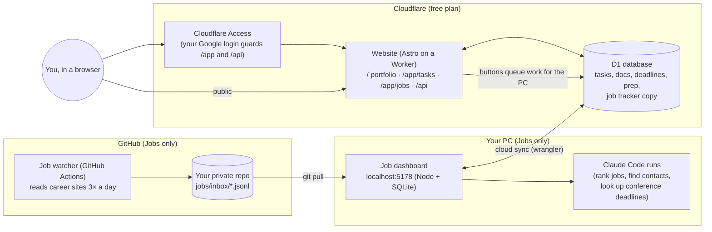

# Portfolio · Tasks · Jobs

A personal website you build with your own AI coding agent (Claude Code, or any agent that reads `CLAUDE.md` / `AGENTS.md`). It has three parts, and **you choose which ones you want**:

| Part | What it is | Where it runs |
|---|---|---|
| **Portfolio** | A public one-page site: about, projects, experience, publications, résumé. | Cloudflare (free), or just on your PC |
| **Tasks** | A private task manager: a Today page with deadline countdowns, Google-Docs-style documents with checklists, a reading list, interview prep (tracks, flashcards, quizzes, questions), coding practice, global search. | Cloudflare (free), or just on your PC |
| **Jobs** | A private job tracker: a watcher that checks company career sites three times a day, a local dashboard where an AI agent ranks the postings against your profile, and a pipeline from *new* to *referral*, *applied* and *interview*. | Your PC (dashboard) + GitHub Actions (watcher), optionally mirrored on Cloudflare |

Build **one, two or all three**. The parts share one website project, and anything you don't choose is switched off (`site/src/owner.config.ts → MODULES`).

## How the pieces fit



- **Portfolio** = the website's public page. Needs nothing but the site.
- **Tasks** = the website's private `/app/tasks` + the D1 database. Optional Auto deadline search needs the Jobs dashboard on your PC (it runs Claude there).
- **Jobs** = the watcher (GitHub Actions) + the dashboard on your PC (`dashboard/`), and optionally the website's private `/app/jobs`, which shows the same data from anywhere.

## Get started (5 minutes to a running copy)

You need **Node 22+**, **git** and an AI coding agent (Claude Code: https://claude.com/claude-code). On Windows, keep the folder at a short path such as `C:codemy-site`: the local database files have long names, and deep folders hit Windows' 260-character path limit (the local database then fails with "internal error").

1. Create your own copy: **Use this template** on GitHub (or clone and push to a new repo). Make it **private** if you will keep your résumé, profile or job data in it.
2. Open the folder in your agent and say: **"set up my project"**. The agent follows `CLAUDE.md`. It will:
   - ask which parts you want (portfolio, tasks, jobs: any two, or all three) and switch the others off;
   - ask about you (name, links, projects, experience; for jobs also your field, target companies and work authorization) and fill in the templates;
   - install, create the local database, and start the site on http://localhost:4321.
3. Look at it, ask the agent for changes, and keep going. Each part has its own guide the agent reads: [`claude/portfolio.md`](claude/portfolio.md), [`claude/tasks.md`](claude/tasks.md), [`claude/jobs.md`](claude/jobs.md).

Prefer to do it by hand? `cd site && npm install && npm run db:migrate:local && npm run dev`, then open http://localhost:4321 (the private pages ask for a local sign-in; set `DEV_USER_EMAIL` in `site/.dev.vars`, copied from `.dev.vars.example`).

## Deploy it (optional): Cloudflare

Everything runs on your PC without deploying. To put it online:

- **Cloudflare Workers + D1 (free plan)** hosts the website and its database. One command deploys: `cd site && npm run deploy`.
- **Cloudflare Access (Zero Trust, free up to 50 users)** puts your Google login in front of `/app` and `/api`, so only you can open Tasks and Jobs. The public portfolio stays public.
- You'll get an address like `https://my-site.<you>.workers.dev`, or a free `*.pages.dev` one through `pages-proxy/`, or your own domain.

The step-by-step guide (accounts, database, login, secrets) is [`docs/deploy-cloudflare.md`](docs/deploy-cloudflare.md). Your agent can walk you through it, but **you** create the accounts and paste the secrets; it never types passwords.

## Example content

- `examples/study-pack/`: an optional interview-prep pack (computer architecture, memory systems, RTL/CDC/STA, ML accelerators, GPUs, compilers, OS): ~500 flashcards, ~350 quiz questions, ~170 interview questions and video/reading tracks. Load it or start blank.
- The portfolio ships with placeholder text and blank images; the job tracker with a handful of example companies.

## What's in the folder

```
site/            the website (Astro + React): portfolio, /app/tasks, /app/jobs, /api; D1 schema in site/migrations
dashboard/       the local job dashboard (Node, SQLite, React) and its CLI (node dashboard/cli …) used by agents
watcher/         the job watcher (Node, no dependencies), run by .github/workflows/job-watcher.yml
targets/         companies the watcher reads (companies.csv) and research institution ids
profile/         your profile (the only source of facts agents may use about you)
career/          message templates (referrals, cold emails)
examples/        optional study pack and sample data
docs/            deployment guide
claude/          agent guides per part: portfolio.md, tasks.md, jobs.md (CLAUDE.md combines them)
```

## Ground rules the agent follows

- It never invents facts about you: everything comes from `profile/master_profile.md`, and it asks when something is missing.
- It never submits applications, sends e-mails or messages, creates accounts or types passwords. You do those.
- It never puts secrets in files or git (Cloudflare secrets go in with `wrangler secret put`).
