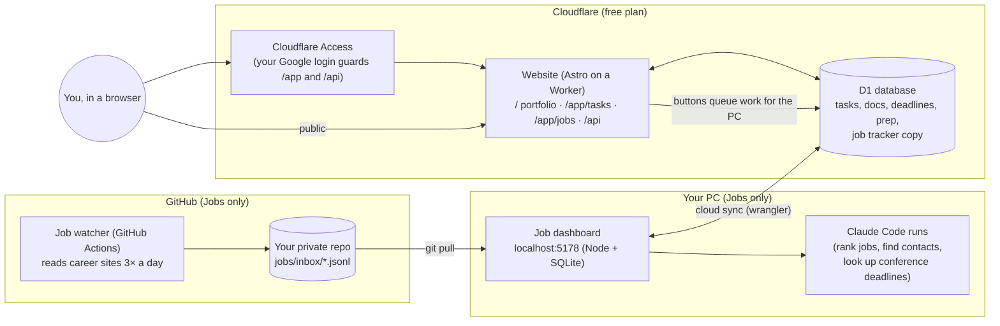

# How it works (for the technically curious)

You don't need this page to use the project: your AI agent reads it. It explains how the parts connect.

## The pieces and how they talk



- **Portfolio** = the website's public page. Needs nothing but the site.
- **Tasks** = the website's private `/app/tasks` + the D1 database. Optional Auto deadline search needs the Jobs dashboard on your PC (it runs Claude there).
- **Jobs** = the watcher (GitHub Actions) + the dashboard on your PC (`dashboard/`), and optionally the website's private `/app/jobs`, which shows the same data from anywhere.


## What's in the folder

```
site/            the website (Astro + React): portfolio, /app/tasks, /app/jobs, /api; D1 schema in site/migrations
dashboard/       the local job dashboard (Node, SQLite, React) and its CLI (node dashboard/cli …) used by agents
watcher/         the job watcher (Node, no dependencies), run by .github/workflows/job-watcher.yml
targets/         companies the watcher reads (companies.csv) and research institution ids
profile/         your profile (the only source of facts agents may use about you)
career/          message templates (referrals, cold emails)
examples/        optional study pack and sample data
docs/            deployment guide
claude/          agent guides per part: portfolio.md, tasks.md, jobs.md (CLAUDE.md combines them)
```


## Tech used
- Website: Astro + React, on a Cloudflare Worker; database: Cloudflare D1 (SQLite); login: Cloudflare Access.
- Job dashboard: Node.js + Express + SQLite + React (MUI), runs on your PC at http://localhost:5178.
- Job watcher: plain Node.js, run by GitHub Actions three times a day.
- AI work (ranking jobs, drafting messages, looking up deadlines): Claude Code, started by the dashboard.
